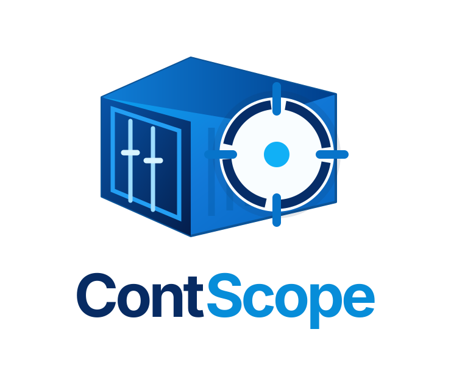
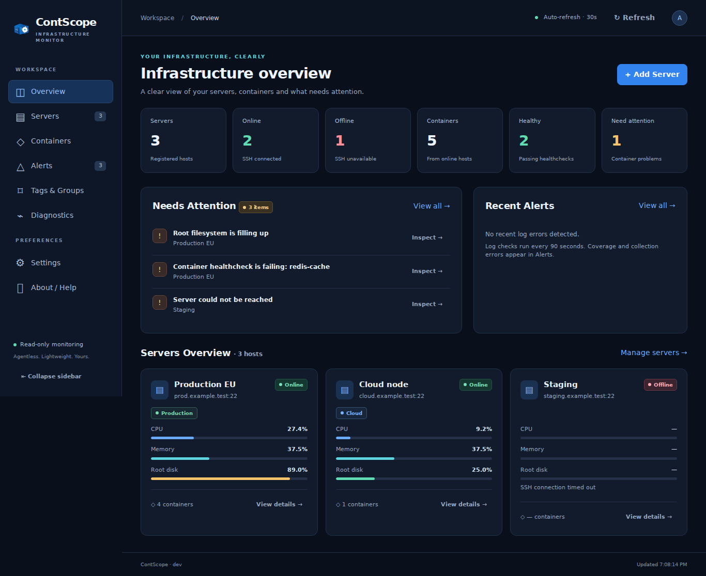
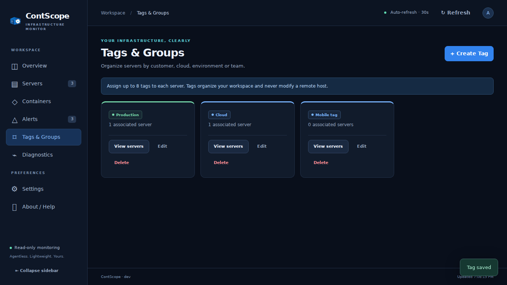

# ContScope



**Lightweight, self-hosted Linux server and Docker container monitoring over SSH.**

One container. No monitoring agents. No external database. A read-only dashboard for managing visibility across customers, clouds and environments.



*Example workspace from controlled test fixtures, not production infrastructure.*

## Install and update

Clone this repository and start the ready-to-run beta image:

```bash
git clone https://github.com/ttavares369/ContScope.git
cd ContScope
docker compose up
```

Open **http://localhost:8080**. On the first run, ContScope prints a random password for the `admin` account in the container logs. Save it. Restarts retain the account without printing the password again. For detached installations:

```bash
docker compose up -d
docker compose logs contscope
```

The default Compose uses `ghcr.io/ttavares369/contscope:beta`, binds to loopback and preserves its named data volume. Use an SSH tunnel or an HTTPS proxy when accessing a remote installation. Protect container logs: the initial password may remain in log storage and terminal scrollback.

Update an existing installation **from its existing Compose directory**, preserving the original project name and volume:

```bash
docker compose pull contscope
docker compose up -d contscope
```

No server re-registration or storage migration is needed. Do not remove the data volume. Back it up before upgrading. Set `CONTSCOPE_IMAGE_TAG` to choose a published version rather than following beta. AMD64 and ARM64 images are published by GitHub Actions after changes to `main`; `v*` tags belonging to `main` publish versioned images. Check the publishing workflow for the actual release status.

To build locally:

```bash
docker compose -f compose.dev.yaml up --build
```

## Connect your first server

1. Select **Add Server** from Overview or Servers.
2. Enter the server name, IP/hostname, SSH username and password. Names support up to 64 ASCII letters, digits, spaces, underscores, dots and hyphens.
3. For key authentication, select **Private key** and paste or upload an unencrypted SSH private key. Passphrase-encrypted keys are not supported.
4. The SSH port defaults to **22**; change it under **Advanced options** if necessary.
5. Click **Connect & Add Server**. The connection is tested before credentials are saved.

The first connection uses **trust on first use (TOFU)**: the SSH host key is discovered and pinned after successful authentication. Verify this first connection independently through a trusted network or server console. Future identity changes fail closed. Editing credentials never silently replaces that trust. Address changes are checked against the already trusted public key.

Servers remain registered if monitoring fails. Offline means the SSH collection failed; it does **not** prove the server itself is down. Docker metrics require the SSH user to access Docker. That permission can confer root-equivalent privileges even though ContScope only issues read-only commands.

## Workspace

| Area | Purpose |
| --- | --- |
| Overview | Server/container totals, priority findings, compact server cards and recent log alerts |
| Servers | Search by name/IP, tag/status filters, sorting, cards/list view and server details |
| Server details | Summary, Containers, Logs, Diagnostics and Settings tabs |
| Containers | All connected-host containers; name/server/status filters; CPU/memory sorting; details and logs |
| Alerts | Severity/server/origin filters, observed evidence, suggested checks and log scan coverage |
| Tags & Groups | Create, rename, recolor, delete and assign reusable tags |
| Diagnostics | Request processes, storage, network and recent Docker events explicitly |
| Settings | Change the administrative password and configure optional Telegram notifications |
| About / Help | Version/build/commit/license, GitHub links, recovery instructions and optional support report |

The sidebar collapses on desktop and opens as a drawer on mobile. Forms use accessible native dialogs, keyboard focus and inline errors. Tables become labeled cards on small screens. Preferences for sidebar and server view stay in the browser.

### Servers and credentials

Open a server's **Settings** tab to edit its name, host, port, user or SSH credential, assign tags, test the connection or remove it. Leave the credential blank to retain it. Name-only edits do not require a connection. Changes affecting SSH are verified before replacing the working configuration. Failed verification retains existing settings and credentials.

Legacy installations using a mounted SSH key can retain that configuration when editing names/tags. Switching to managed credentials reads the existing trusted `known_hosts` entry and verifies the connection; it never silently discovers a replacement identity. Restore the original trust file if it is missing.

Removing a server removes monitoring registration and the managed encrypted SSH credential. It does not change the remote host, Docker containers, images or volumes.

### Tags

Create tags from **Tags & Groups**, choose from eight colors, and assign up to eight tags from a server's Settings tab. A maximum of 80 reusable tags is supported. Tag names are unique without regard to case. The Servers page includes tag and Untagged filters. Deleting a tag detaches it from associated servers while preserving their other tags and connection settings.



### Containers, logs and findings

Friendly names and descriptions are local metadata linked to the server and original Docker container name. **Details** opens metadata editing and a bounded Docker inspect result. ContScope never renames the actual container.

**Logs** retrieves up to 200 timestamped lines (128 KiB) on demand with a local text filter. Advanced commands are fixed scripts, never arbitrary user commands. Environment variables and full Docker inspect payloads are not exposed. Logs may still contain private information: limit dashboard access to trusted users.

CPU and network are short samples, not historical graphs. High CPU/RAM, root disk pressure, unhealthy/restarting/dead containers and SSH/Docker availability generate explainable findings. Cleanly exited jobs and containers without a healthcheck are not automatically problems. The Healthy counter counts running containers with a passing healthcheck.

Snapshots refresh every 30 seconds while the page is visible, share a 25-second server-side cache and limit concurrent collection to four hosts. Collection has timeouts and output limits. Diagnostics run only when requested. No continuously expanded process, storage or Docker events panel lives on Overview.

### Log alert coverage

Every 90 seconds the scanner checks up to 200 running containers per host, at most 300 recent log lines each, and 768 KiB of aggregate output. It matches whole words `error`, `fatal`, `panic` and `exception`, so these alerts are heuristics, not proof of root cause. Stable fingerprints deduplicate overlapping scans. The latest 200 alerts are held in memory; restart clears alert history while persisted cursors avoid repeatedly importing old errors.

Collection failures and coverage limits are shown in Alerts. Large log volumes, unavailable logging drivers, pauses and connection failures can cause missed lines. No monitoring continues when ContScope is stopped.

### Telegram (optional)

Open **Settings → Notifications**. Create a bot through Telegram's @BotFather, start a conversation or add it to your group, and enter its bot token and numeric chat ID. **Send test message** tests the entered configuration without saving it. Enable and save to notify about new log errors. Leave the token blank to retain the saved token, or disable notifications without supplying a new token.

The token is encrypted at rest and never returned by a GET API. A 5–1440 minute per-server/container/category cooldown defaults to 30 minutes. Notifications include the server name, container ID abbreviation and category, never raw logs. Telegram is a third-party service; those selected details leave the instance only when enabled or an explicit test is requested. Health snapshot findings are displayed in the dashboard; automatic Telegram delivery is currently limited to log-error alerts.

### Account and recovery

**Settings → Account** changes the local admin password (14–256 characters). The old password immediately stops authenticating new requests; browsers may cache Basic Auth credentials until the tab/browser is reopened. If credentials are overridden through `CONTSCOPE_USER`/`CONTSCOPE_PASSWORD`, change the deployment environment instead.

Reset the automatically managed account locally if needed:

```bash
docker compose exec contscope /usr/local/bin/contscope reset-admin
```

## Persistence and security

The existing JSON files remain compatible: `servers.json`, `server-tags.json`, `container-labels.json`, `ssh-credentials.json`, `local-secret.key`, `telegram.json`, `admin-auth.json` and log cursors live in the data volume. Credentials use AES-256-GCM with a locally generated key. Private files use mode `0600`; directories use `0700`. Back up **the entire volume**, including its encryption key. A missing key is not silently replaced when SSH or Telegram ciphertext exists.

HTTP Basic authentication protects the panel, JavaScript/CSS and API routes. Browser-origin and Fetch Metadata checks reject cross-site mutations. The dashboard applies CSP, frame denial, content-type protection and a no-referrer policy. Dynamic data is escaped or inserted as text. Passwords/private keys never appear in SSH command arguments. SSH errors are classified without returning raw stderr.

The production image runs as a non-root user with a read-only root filesystem and writable `/data` volume and `/tmp`. No Docker socket mount is required. Expose the panel only through HTTPS or a trusted tunnel; Basic Auth itself does not encrypt HTTP traffic. ContScope read-only scripts do not make the remote account's underlying permissions read-only.

## Development and validation

Go 1.23 or later and OpenSSH clients are required for local execution. There are no third-party Go runtime dependencies and no JavaScript framework/runtime in the production container. Frontend files live separately in `web/` and are embedded in the binary.

```bash
export CONTSCOPE_USER=admin
export CONTSCOPE_PASSWORD='replace-with-a-long-random-password'
go test -race ./...
go vet ./...
go run .
```

CI validates Go formatting, JavaScript syntax, authenticated APIs, tag CRUD, persistence, account recovery, encryption, server edit rollback and builds for AMD64/ARM64. A disposable loopback OpenSSH server and real Docker fixture exercise onboarding, pinned identity rejection, Linux/Docker telemetry, logs, diagnostics, editing and credential removal. Browser tests exercise real local CRUD APIs with controlled SSH telemetry fixtures, plus 65 route/viewport checks at 1920×1080, 1366×768, 768×1024, 390×844 and 320×640. Docker checks verify first-run login and persistent tags after container restart.

Browser tests require Node.js only in development:

```bash
npm install --no-save --no-package-lock playwright@1.51.1
npx playwright install --with-deps chromium
go build -o /tmp/contscope-app .
node tests/browser.cjs
```

See [mobile overview](docs/images/overview-mobile.png). Screenshots use fixtures; they do not claim verification against production customer servers or delivery to a real Telegram chat.

## Limitations and support

No historical charts, Kubernetes/Podman integration, configurable thresholds, alert acknowledgment or automatic remote remediation is implemented. Telegram network delivery depends on the instance's connectivity and the bot's permissions. Local tests cannot certify every remote Linux/Docker configuration or hundreds of hosts under load.

ContScope is licensed under **Apache 2.0**. Earlier MIT revisions retain their original license. Support the project by starring the repository, reporting bugs or contributing. Donation payments remain unavailable until a verified funding destination is configured.

For professional Linux/Docker assistance, contact [Jupiter TI](https://www.jupiterti.com/servicos) or [tiago@jupiterti.com](mailto:tiago@jupiterti.com). Prepare an optional report from About / Help, inspect and edit it, then export JSON and share it yourself. Automated redaction is best effort. ContScope never sends the report automatically.
